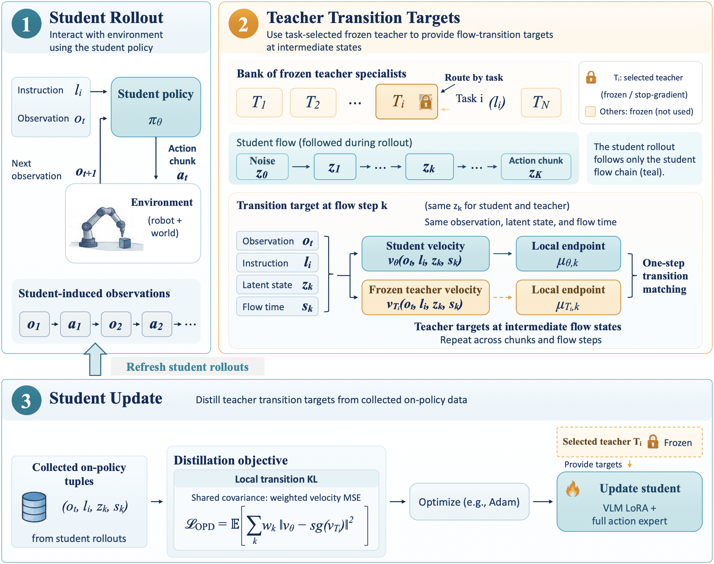

# VLA-MOPD: On-Policy Distillation for Multi-Task VLA Policy Consolidation

**面向多任务 VLA 策略整合的在线蒸馏。** Student 使用自己在 LIBERO 中采集的 rollout；按任务路由的冻结专家 Teacher 在中间 flow 状态提供 transition target。本 release 提供 global step 500 的 Pi0.5 Student 完整 checkpoint，包含训练后的 language-model-only LoRA（rank 32）。

[English](README.md) · [简体中文](README.zh-CN.md) · [方法和评测详情](docs/opd-gs500.md) · [训练配置](examples/embodiment/config/opd/libero/)

## 框架图



## LIBERO 评测指标

以下仅报告已发布的 global step 500 OPD Student 的 success-once rate（%），每个 suite 评测 500 个 episode。

| 方法 | Spatial | Object | Goal | LIBERO-10 | 平均 |
| --- | ---: | ---: | ---: | ---: | ---: |
| **VLA-MOPD（OPD Student，gs500）** | **99.4** | **99.0** | **98.0** | **99.0** | **98.85** |

四-suite 非加权平均为 98.85%（1977/2000 成功），结果来自一个训练 seed，指标为 success-once。归档结果和评测配置见[评测详情](docs/opd-gs500.md)。

## 快速入门：评测已发布 Student

### 已发布的模型权重

| 用途 | Hugging Face 模型 | 说明 |
| --- | --- | --- |
| Student 初始化 / Base SFT | [`RLinf/RLinf-Pi05-LIBERO-SFT`](https://huggingface.co/RLinf/RLinf-Pi05-LIBERO-SFT) | Student 初始化，同时提供 LIBERO 归一化统计 |
| S/O/G Teacher | [`yxuan1234/Pi05-LIBERO-SOG-Teacher`](https://huggingface.co/yxuan1234/Pi05-LIBERO-SOG-Teacher) | Spatial、Object、Goal 共用的冻结 PPO Teacher |
| LIBERO-10 Teacher | [`yxuan1234/Pi05-LIBERO10-Teacher`](https://huggingface.co/yxuan1234/Pi05-LIBERO10-Teacher) | LIBERO-10 使用的冻结 PPO Teacher |
| OPD Student，global step 500 | [`yxuan1234/Pi05-LIBERO-OPD-Student-gs500`](https://huggingface.co/yxuan1234/Pi05-LIBERO-OPD-Student-gs500) | 发布的蒸馏模型，也是上方评测结果对应的模型 |

三个 `yxuan1234` 模型仓库目前为私有，需要有权限的 HF 账号；RLinf Base SFT 仓库为公开。

### 1. 安装 RLinf OpenPI + LIBERO 环境

按照 [RLinf 官方安装文档](https://rlinf.readthedocs.io/zh-cn/latest/rst_source/start/installation.html)配置环境，然后在仓库根目录运行：

```bash
bash requirements/install.sh embodied --model openpi --env libero
```

按照 [RLinf LIBERO 文档](https://rlinf.readthedocs.io/zh-cn/latest/rst_source/examples/embodied/libero.html)准备 LIBERO 资产和初始状态。

### 2. 下载权重并设置路径

复现训练需要下载 Base SFT 和两个 Teacher；只评测发布的 OPD 模型时，下载 Base SFT 和 OPD Student 即可。LIBERO-10 Teacher 仓库的 checkpoint 位于仓库根目录的 `model_state_dict/` 下，其本地仓库目录就是模型路径。

```bash
hf download RLinf/RLinf-Pi05-LIBERO-SFT \
  --local-dir /path/to/RLinf-Pi05-LIBERO-SFT
hf download yxuan1234/Pi05-LIBERO-SOG-Teacher \
  --local-dir /path/to/Pi05-LIBERO-SOG-Teacher
hf download yxuan1234/Pi05-LIBERO10-Teacher \
  --local-dir /path/to/Pi05-LIBERO10-Teacher
hf download yxuan1234/Pi05-LIBERO-OPD-Student-gs500 \
  --revision 282d6ce8dd9c1ce34ea2bfe06fb88a40cee52cdf \
  --local-dir /path/to/Pi05-LIBERO-OPD-Student-gs500

export PI05_SFT_MODEL_DIR=/path/to/RLinf-Pi05-LIBERO-SFT
export PI05_SOG_TEACHER_DIR=/path/to/Pi05-LIBERO-SOG-Teacher
export PI05_LIBERO10_PPO_TEACHER_DIR=/path/to/Pi05-LIBERO10-Teacher
export PI05_OPD_CHECKPOINT_DIR=/path/to/Pi05-LIBERO-OPD-Student-gs500/actor
export EMBODIED_PATH="$PWD/examples/embodiment"
export ROBOT_PLATFORM=LIBERO
export LIBERO_TYPE=standard
export MUJOCO_GL=egl
export PYOPENGL_PLATFORM=egl
```

Base SFT 用于 Student 初始化并提供 LIBERO normalization statistics。请连接分配给当前任务的 Ray 集群；placement 使用物理 GPU rank。

### 复现 OPD 训练至 global step 500

主要双 Teacher 配置为 `libero_sog_plus10_opd_ppo120_teacher_vlm_save50_x5lr`：Spatial/Object/Goal 路由到同一个 S/O/G Teacher，LIBERO-10 路由到 LIBERO-10 Teacher。

```bash
export RAY_ADDRESS=127.0.0.1:YOUR_RAY_PORT
export CUDA_VISIBLE_DEVICES=0,1,2,3,4,5,6,7
export OPD_GPU_PLACEMENT=0-7

python examples/embodiment/train_embodied_agent.py \
  --config-path config \
  --config-name opd/libero/libero_sog_plus10_opd_ppo120_teacher_vlm_save50_x5lr \
  runner.max_steps=500 \
  runner.logger.log_path=/path/to/training-results
```

该配置从公开 Base SFT 初始化，训练 language-only LoRA32 Student 和完整 action expert，并每 50 步保存 checkpoint。要对比报告结果，请保持模型、仿真器和 rollout 设置一致；不同环境或 seed 下结果可能变化。

### Teacher-as-reference OPD：Spatial 适应与 Object 保留

配置文件：[`spatial_opd_objkl.yaml`](examples/embodiment/config/opd/libero/spatial_opd_objkl.yaml)。
Student 在 Spatial 和 Object 上采集在线 rollout，每条样本只路由到一个冻结 Teacher：

| Suite | 路由 Teacher | 用途 |
| --- | --- | --- |
| Spatial | `PI05_SOG_TEACHER_DIR`（PPO 专家） | 学习专家的 Spatial 能力 |
| Object | `PI05_SFT_MODEL_DIR`（冻结 Base SFT） | 保持初始策略的 Object 能力 |

两者使用同一种 OPD step-mean matching loss；每条样本只有一个 Teacher target，
不额外叠加 reference loss。配置名中的历史名称 `objkl` 指的是用 Base SFT
作为 Object 的 Teacher。

按上面的教程安装环境、下载 Base SFT 和 S/O/G Teacher 并设置路径后，运行：

```bash
export RAY_ADDRESS=127.0.0.1:YOUR_RAY_PORT
export CUDA_VISIBLE_DEVICES=0,1,2,3,4,5,6,7
export OPD_GPU_PLACEMENT=0-7

python examples/embodiment/train_embodied_agent.py \
  --config-path config \
  --config-name opd/libero/spatial_opd_objkl \
  runner.logger.log_path=/path/to/reference-opd-results
```

suite 调度、episode horizon、训练步数和每 50 步保存 checkpoint 均由配置文件指定。
这是独立的适应/保留配置，不是上方四-suite gs500 主实验的配置。详见[reference 路由说明](docs/opd-reference-kl.md)。

### 3. 运行四-suite 评测

每个 suite 的 horizon 和 rollout 长度已定义在 `evaluations/libero/` 对应的 YAML 中。以下命令设置归档评测使用的 sampler 参数：

```bash
for suite in spatial object goal 10; do
  python evaluations/eval_embodied_agent.py \
    --config-path libero \
    --config-name "libero_${suite}_opd_vlm_lora_eval" \
    env.eval.seed=0 \
    env.eval.use_ordered_reset_state_ids=false \
    rollout.model.openpi.noise_method=flow_sde \
    rollout.model.openpi.noise_level=0.3 \
    rollout.model.openpi.train_expert_only=true \
    runner.logger.log_path="/path/to/evaluation-results/gs500/$suite" || break
done
```

评测入口会恢复完整 checkpoint 并在内存中 merge LoRA，不需要额外转换或预先 merge。更多信息见[完整评测教程](docs/opd-gs500.md)和[训练配置说明](docs/opd-training-launch.md)。

本实现基于 [RLinf](https://github.com/RLinf/RLinf)；上游框架论文见 [RLinf paper](https://arxiv.org/abs/2509.15965)。VLA-MOPD 预印本发布后会补充论文链接。
